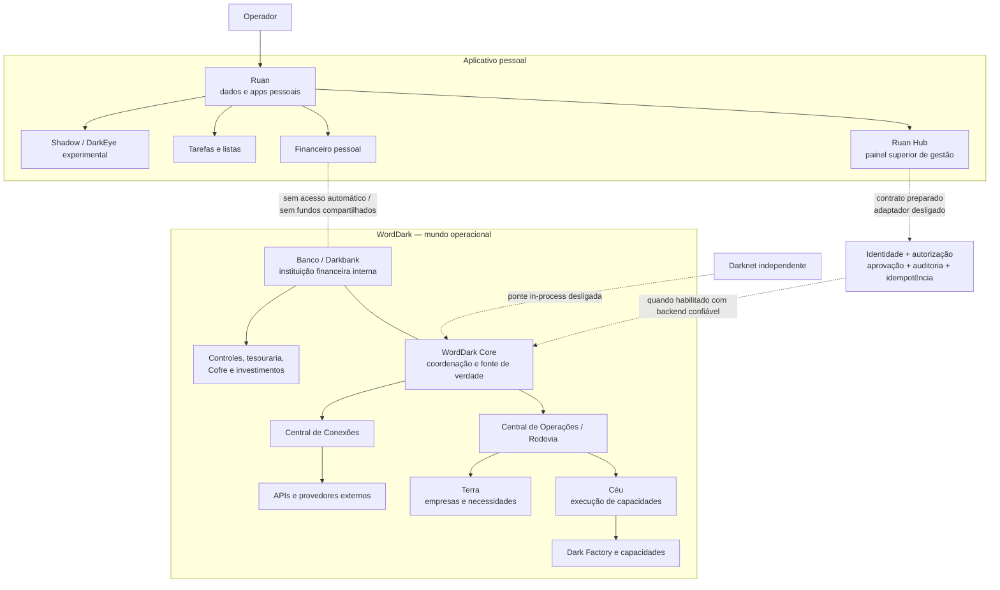

# Mapa da arquitetura — Ruan, Hub e WordDark

Este mapa representa a arquitetura pretendida e distingue as ligações implementadas das que ainda estão fechadas. **Uma linha no mapa não significa que a conexão esteja ativa em produção.**

## Mapa lógico

## Propriedade e responsabilidade

| Parte | Responsabilidade | Estado de integração |
|---|---|---|
| Ruan | Aplicativo pessoal, dados e navegação privada | Independente; armazenamento principalmente local |
| Ruan Hub | Pedidos, avisos, verificações e acompanhamento superior do mundo | Painel existe; pedidos locais não chegam ao Core |
| WordDark Core | Identidade, autorização, coordenação, roteamento e auditoria | Runtime e contratos existem; falta serviço confiável de controle do Hub |
| Central de Operações / Rodovia | Receber e encaminhar operações | Módulos de runtime e testes existem |
| Céu | Executar capacidades e serviços | Estrutura de execução existe; integração varia por capacidade |
| Terra | Representar empresas, canais, clientes e necessidades externas | Estrutura existe; cobertura operacional ainda parcial |
| Central de Conexões | Guardar e usar credenciais/adaptadores externos sob controle | Gateway e módulos OAuth existem; configuração/segurança de produção pendente |
| Banco / Darkbank | Instituição financeira interna do WordDark | Responsabilidade definida; não é banco real operacional |
| Darknet | Sistema independente de acesso e preparação de solicitações | Ponte in-process existe, desligada por padrão |
| Shadow / DarkEye | Ferramentas pessoais experimentais | Não faz parte do WordDark nem da Darknet |

## Fluxo de um pedido — alvo

1. O operador descreve a necessidade no Ruan Hub.
2. O Hub envia um envelope com ID idempotente por uma sessão autenticada.
3. O Core valida a identidade confiável, a permissão para a ação e a aprovação exigida.
4. O Core registra a decisão na auditoria persistente.
5. O adaptador de controle encaminha o pedido à Central de Operações em ambiente TEST até que haja validação de produção.
6. O Core retorna um identificador e um estado real; o Hub consulta esse estado e apresenta o resultado.
7. A execução especializada ocorre no Céu, a entidade/necessidade pode pertencer à Terra, e o resultado retorna à operação original.

## Implementação feita nesta etapa

- Criado `core/connections/ruan-hub-control-adapter.js`: contrato de entrada do Hub com default-deny, identidade confiável separada do pedido, autorização, aprovação, auditoria, idempotência injetada e ambiente fixado em TEST.
- Criados testes para modo desligado, identidade ausente, autorização negada, aprovação ausente, falha de auditoria, ausência de idempotência, descoberta de capacidades, consulta de estado e submissão sem duplicação.
- Hub agora rotula novos pedidos como `RASCUNHO_LOCAL` / `LOCAL_ONLY`; a tela não afirma que foram recebidos pelo WordDark.
- Não foi criado endpoint HTTP nem foi conectada uma sessão de operador real. O adaptador permanece desligado por padrão.

## O que falta para ativar a integração real

1. Identidade de operador autenticada no backend (não um ID fornecido pelo navegador).
2. Política de permissões e aprovações ligada à fonte de identidade do Core.
3. Auditoria persistente, protegida contra alteração e com retenção definida.
4. Armazenamento idempotente atômico e durável; o mapa/in-memory store dos testes não é suficiente.
5. Serviço backend autenticado para submeter pedidos e consultar operações, com limites de entrada, proteção contra replay, CORS/CSRF conforme o modelo de sessão, rate limit e gestão de segredos.
6. Consulta de estado/resultado baseada em IDs reais do registro do Core; não inferir “em execução” de armazenamento local.
7. Testes de integração com backend real em ambiente de staging, incluindo falhas, concorrência, permissões e recuperação.
8. Só depois, revisão de segurança e autorização explícita para ativação fora de TEST.

## Limites que permanecem

- Nenhuma publicação externa, movimentação financeira, pagamento ou investimento real foi ativado.
- Não compartilhar dados ou fundos pessoais do Ruan com o WordDark.
- Não tratar mocks, testes locais, telas ou registros locais como evidência de operação em produção.
