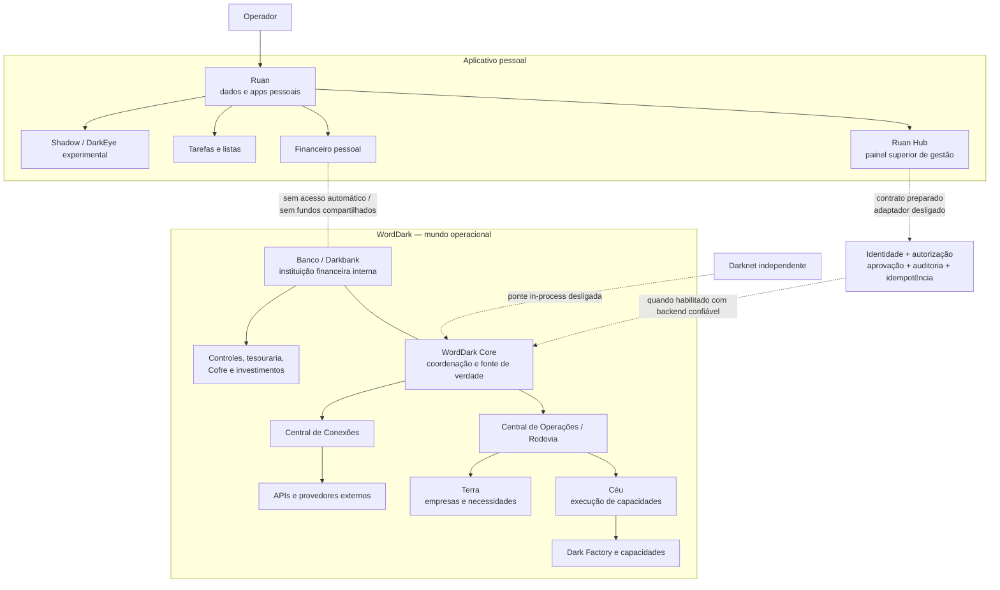

# Mapa da arquitetura — Ruan, Hub e WordDark

Este mapa representa a arquitetura pretendida e distingue as ligações implementadas das que ainda estão fechadas. **Uma linha no mapa não significa que a conexão esteja ativa em produção.**

## Mapa lógico

## Propriedade e responsabilidade

| Parte | Responsabilidade | Estado de integração |
|---|---|---|
| Ruan | Aplicativo pessoal, dados e navegação privada | Independente; armazenamento principalmente local |
| Ruan Hub | Pedidos, avisos, verificações e acompanhamento superior do mundo | Painel existe; pedidos locais não chegam ao Core |
| WordDark Core | Identidade, autorização, coordenação, roteamento e auditoria | Runtime e contratos existem; falta serviço confiável de controle do Hub |
| Central de Operações / Rodovia | Receber e encaminhar operações | Módulos de runtime e testes existem |
| Céu | Executar capacidades e serviços | Estrutura de execução existe; integração varia por capacidade |
| Terra | Representar empresas, canais, clientes e necessidades externas | Estrutura existe; cobertura operacional ainda parcial |
| Central de Conexões | Guardar e usar credenciais/adaptadores externos sob controle | Gateway e módulos OAuth existem; configuração/segurança de produção pendente |
| Banco / Darkbank | Instituição financeira interna do WordDark | Responsabilidade definida; não é banco real operacional |
| Darknet | Sistema independente de acesso e preparação de solicitações | Ponte in-process existe, desligada por padrão |
| Shadow / DarkEye | Ferramentas pessoais experimentais | Não faz parte do WordDark nem da Darknet |

## Fluxo de um pedido — alvo

1. O operador descreve a necessidade no Ruan Hub.
2. O Hub envia um envelope com ID idempotente por uma sessão autenticada.
3. O Core valida a identidade confiável, a permissão para a ação e a aprovação exigida.
4. O Core registra a decisão na auditoria persistente.
5. O adaptador de controle encaminha o pedido à Central de Operações em ambiente TEST até que haja validação de produção.
6. O Core retorna um identificador e um estado real; o Hub consulta esse estado e apresenta o resultado.
7. A execução especializada ocorre no Céu, a entidade/necessidade pode pertencer à Terra, e o resultado retorna à operação original.

## Implementação feita nesta etapa

- Criado `core/connections/ruan-hub-control-adapter.js` e documentado em [`RUAN-HUB-CONTROL.md`](./core/connections/RUAN-HUB-CONTROL.md): contrato de entrada do Hub com default-deny, identidade confiável separada do pedido, autorização, aprovação, auditoria, idempotência injetada e ambiente fixado em TEST.
- Criados testes para modo desligado, identidade ausente, autorização negada, aprovação ausente, falha de auditoria, ausência de idempotência, descoberta de capacidades, consulta de estado e submissão sem duplicação.
- Hub agora rotula novos pedidos como `RASCUNHO_LOCAL` / `LOCAL_ONLY`; a tela não afirma que foram recebidos pelo WordDark.
- Não foi criado endpoint HTTP nem foi conectada uma sessão de operador real. O adaptador permanece desligado por padrão.

## O que falta para ativar a integração real

1. Identidade de operador autenticada no backend (não um ID fornecido pelo navegador).
2. Política de permissões e aprovações ligada à fonte de identidade do Core.
3. Auditoria persistente, protegida contra alteração e com retenção definida.
4. Armazenamento idempotente atômico e durável; o mapa/in-memory store dos testes não é suficiente.
5. Serviço backend autenticado para submeter pedidos e consultar operações, com limites de entrada, proteção contra replay, CORS/CSRF conforme o modelo de sessão, rate limit e gestão de segredos.
6. Consulta de estado/resultado baseada em IDs reais do registro do Core; não inferir “em execução” de armazenamento local.
7. Testes de integração com backend real em ambiente de staging, incluindo falhas, concorrência, permissões e recuperação.
8. Só depois, revisão de segurança e autorização explícita para ativação fora de TEST.

## Limites que permanecem

- Nenhuma publicação externa, movimentação financeira, pagamento ou investimento real foi ativado.
- Não compartilhar dados ou fundos pessoais do Ruan com o WordDark.
- Não tratar mocks, testes locais, telas ou registros locais como evidência de operação em produção.

## Camada de conhecimento recebido pela Darknet

```mermaid
flowchart LR
    API["APIs externas / fontes"] --> CC["Central de Conexões<br/>adapter + credenciais"]
    CC --> DN["Darknet<br/>pipeline de aquisição"]
    DN --> AUTH["Identidade + autorização<br/>auditoria"]
    AUTH --> INTAKE["WordDark Knowledge Adapter"]
    INTAKE --> PENDING["Registro pendente<br/>RECEIVED_PENDING_REVIEW"]
    PENDING --> REVIEW["Validação / revisão"]
    REVIEW --> LIB["Biblioteca local ou central<br/>conforme política"]
    LIB --> SKY["Céu / capacidades"]
```

O pipeline está implementado como contrato de integração e usa adaptadores de provedores injetados. `darknet/darknet-central-connection-provider.js` encaminha pesquisas ao gateway da Central de Conexões usando uma conta e capacidade já autorizadas, sem expor credenciais à Darknet. Ele não ativa por si só uma API externa. A entrada WordDark também permanece desligada por padrão, exige identidade confiável e recebe conteúdo como pendente de revisão. A infraestrutura de persistência durável e idempotência agora tem adapters Firestore; ainda faltam conectar os adapters reais já disponíveis ao gateway, injetar identidade/autorização/auditoria reais, configurar IAM e validar a cadeia completa em staging.

## Preparação operacional de conhecimento

A composição de produção fica em `darknet/darknet-knowledge-runtime.js`. O adapter `worddark/runtime/world/core/connections/knowledge-search-adapter.js` fornece o contrato de registro para os handlers das APIs já configuradas via `registerKnowledgeSearchAdapter`. Ela pode receber a instância Firestore já criada no backend e construir os adapters duráveis usando as coleções `worddarkKnowledgeIntake` e `worddarkCentralLibrary`. O arquivo canônico recebe apenas registros de conhecimento validados e usa ID determinístico para evitar duplicação em novas tentativas.

O runtime também protege revisão, listagem de pendências e busca validada: cada chamada precisa passar por `authenticateService`; leituras exigem autorização e auditoria próprias; revisão exige aprovação. Um objeto enviado pelo navegador com `authenticated: true` não constitui identidade confiável.

**Evidência de integração:** `darknet/darknet-knowledge-runtime.integration.test.js` cobre o caminho completo com gateway, adaptador de pesquisa, identidade simulada, entrada pendente, revisão, arquivo e leitura validada. É uma prova de contrato em teste, não uma chamada real à API nem um teste do projeto Cloud.

**Ainda não é uma ativação oficial.** Falta ligar a identidade/autorização/auditoria reais, registrar os adapters externos reais no gateway com conta e capacidade `KNOWLEDGE_RESEARCH`, configurar IAM/regras das coleções no projeto real e passar por uma execução controlada em staging. Não ativar com callbacks permissivos de teste.

## Conexões persistidas — nova fronteira backend

`worddark/runtime/world/core/connections/persisted-knowledge-gateway.js` provides a server-only gateway for the Darknet's read-only research actions. It loads account metadata and tokens from the encrypted persistent connection store, requires trusted service identity, authorization and audit before/after provider calls, and filters secret-bearing fields from returned data. The Darknet provider passes the runtime-authenticated context only through the in-process backend call. This gateway is disabled by default, has no HTTP route, and supports only `SEARCH_KNOWLEDGE` and `FETCH_KNOWLEDGE`.

This closes a code-level composition gap between the durable connection store and knowledge adapters; it does **not** prove the real provider handlers, capability grants, IAM, Firestore/KMS configuration, or staging deployment are active. A backend operator must explicitly grant `KNOWLEDGE_RESEARCH` to the persisted account through a trusted grant flow before any provider request can run.

## Composição autenticada do Hub → Core

Foi criado `core/connections/ruan-hub-control-runtime.js` para compor o adaptador de controle com a autenticação de operador do backend. O runtime exige autenticador confiável, autorização, auditoria marcada como durável, idempotência marcada como durável/atômica, catálogo e centro de operações antes de permitir `enabled: true`. Encaminha apenas a identidade produzida pelo autenticador; não confia em `actorId` enviado pelo navegador. A submissão permanece em `TEST`, sem rota HTTP, e o runtime fica desligado por padrão.

**Estado:** composição e testes de contrato adicionados. Ainda não existe sessão autenticada real, store de auditoria/idempotência ligado à nuvem nem endpoint de backend. Por isso, o Hub continua mostrando rascunhos locais e esta composição não foi ativada.

## Cadeia comercial Terra → Core → Céu

A integração de contrato está organizada em duas fronteiras:

- Terra demanda → lead comercial: `worddark/runtime/world/core/earth-commercial-intake-adapter.js`; preserva `sourceDemandId` e o contexto do pedido.
- Pedido comercial aceito → Core: `worddark/runtime/world/core/commercial-order-operation-bridge.js`; exige operador autenticado, autorização, aprovação, auditoria e idempotência injetadas.
- O Core encaminha a operação pela Rodovia para a capacidade do Céu/Dark Factory; o resultado retorna com ID rastreável.
- Uma operação interna concluída leva o pedido comercial a `REVIEW`; não declara que a entrega ao cliente foi feita.

O teste `worddark/runtime/world/earth/commercial-world.integration.test.js` percorre a cadeia com a Terra comercial e o Core/Dark Factory montados no próprio cenário. `worddark/runtime/world/core/terra-commercial-core.integration.test.js` isola os contratos dos dois adapters com Core simulado.

**Estado:** integração de código aprovada em CI. Identidade, auditoria e idempotência reais, persistência multiusuário e staging continuam pendentes. Não há endpoint novo, publicação, pagamento ou deploy ativado.

Nota de evidência: a integração Terra → Core → Dark Factory passou em CI no ambiente TEST. Os módulos executores de conteúdo, identidade, autorização, auditoria e idempotência usados no cenário são simulados; isso não demonstra produção real nem publicação ativa.
